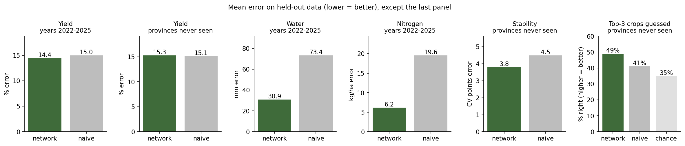
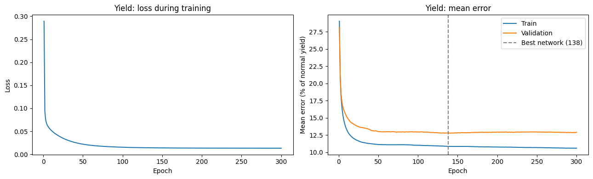
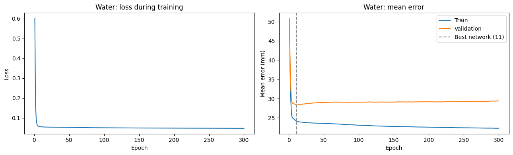
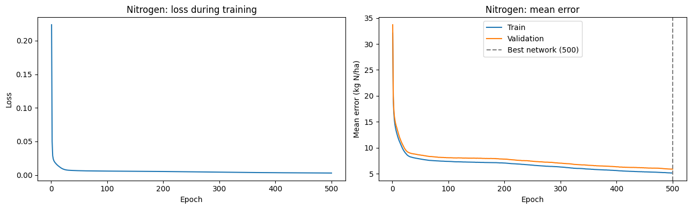
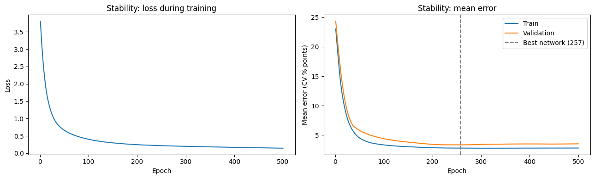

# FarmerBud: results in detail

*[Versione italiana](risultati.md)* · All numbers come from `02_AI_Model/1_training_networks_EN.ipynb` (saved with its outputs) unless a line says otherwise.

## How we test
| Part | Years / provinces | Used for |
|---|---|---|
| Train | 2006-2018 | updating the weights |
| Validation | 2019-2021 | choosing the epoch and the settings (e.g. `alpha`) |
| **Test** | **2022-2025** | only the final score, never for any choice. Includes the 2022 drought |
| **New provinces** | one province at a time left out (33 runs) | the app's real situation: a field in a place the network has never seen |

Every network is compared with a **naive baseline**: the crop's average in the training data. If a network does not beat it, it adds nothing.

## 1. Yield network (the core AI)
- **Test 2022-2025:** mean error 14.4% of the normal yield, naive 15.0%. A small gain: with other random seeds the network gives 14.4-15.5%, so on average it is about level with the naive rule.
- **Provinces never seen:** 15.3% against 15.1%. Row by row, the network does **not** beat the naive rule in a new place.
- **Ranking (what the app does):** for each province we took the 3 crops that really did best and counted how many each method got right. Network **49%**, naive rule 41%, chance 35%. Rank correlation (Spearman) with the true order: 0.37 for the network, 0.17 for the naive rule.
- **Setting chosen on validation data:** `alpha` 0.001 learned by heart (test 16.7%), 0.1 was best on validation (12.8%) and we kept it, 1.0 was too rigid.

**Error by crop, test 2022-2025 (% of normal yield)**
| Crop | Network | Naive |
|---|---|---|
| soft wheat | **10.0** | 10.6 |
| rice | **10.9** | 13.0 |
| durum wheat | 13.4 | 13.3 |
| soybean | **13.9** | 16.9 |
| barley | 14.4 | 14.1 |
| sugar beet | **15.5** | 17.4 |
| maize | **15.6** | 18.5 |
| sorghum | 16.5 | **15.6** |
| rapeseed | 16.6 | **15.6** |
| sunflower | 17.1 | **14.7** |

The network helps most on the summer crops that suffer from drought (maize, soybean, sugar beet) and on rice. It is worse than naive on sunflower, sorghum and rapeseed, which are grown on small areas in many provinces.

**2022 drought (average relative yield, 1.00 = normal)**
| Crop | True | Network | Naive |
|---|---|---|---|
| maize | 0.81 | 0.89 | 0.99 |
| soybean | 0.85 | 0.93 | 0.99 |
| sugar beet | 0.77 | 0.92 | 0.99 |
| rice | 0.87 | 1.00 | 1.01 |
| soft wheat | 1.02 | 1.06 | 1.01 |

The network sees the drought from the climate alone (right direction for maize, soybean, sugar beet), but it is too mild. It misses rice, probably because rice is flooded and suffered from the lack of river water, something our climate variables do not measure.

**Error by region, provinces never seen (% of normal yield)**
| Region | Network | Naive |
|---|---|---|
| Veneto | 13.5 | 13.3 |
| Emilia-Romagna | 14.7 | 14.5 |
| Lombardy | 15.4 | 15.1 |
| Piedmont | 17.8 | 18.0 |

**Biggest mistakes (provinces never seen)**
| Province, year, crop | True | Network | Why we think it fails |
|---|---|---|---|
| Biella 2012, maize | 1.60 | 0.78 | very few hectares of maize: ISTAT yields of small areas are noisy |
| Torino 2025, soybean | 1.51 | 0.74 | 2025 data are still provisional; one climate point for a large province |
| Vercelli 2010-2011, sunflower | 0.32 | 1.05 | marginal crop in a rice province: tiny area, unusual results |

## 2. Water network
- **Test 2022-2025:** 31 mm against 73 mm of the naive rule.
- It learns in about 10 epochs and then stops improving. It cannot go below about 25-30 mm because it only sees season totals, while the FAO-56 formula works month by month: 100 mm of rain in March do not help maize in July.
- In 2022 the formula gave maize 323 mm, the network 345 mm, the naive rule 216 mm.
- **Limit:** for rice the value is evapotranspiration only; a flooded paddy needs much more water.

## 3. Nitrogen network
- **Test 2022-2025:** 6.2 kg/ha against 19.6 kg/ha. Worst crop: maize (11.2 kg/ha), because the official sheet has steps (150 kg/ha for 6-9 t/ha, 240 kg/ha for 10-14 t/ha) and a neural network draws a smooth curve.
- The farmer's choices (previous crop alfalfa, organic matter, residues ploughed in) are not in the ISTAT data: they are **simulated** at random so that the network sees every combination.

## 4. Stability network
- Target: the real coefficient of variation (CV) of the relative yield of each province × crop with at least 10 years: 255 rows.
- **7 provinces never seen:** 3.8 CV points against 4.5 of the naive rule (the crop's median CV).
- **Why a separate network:** we first tried to get stability by running the yield network on 20 years of climate. It saw only about a third of the real swings (median CV 4.6% against 14.6% in reality, correlation 0.22). A network trained directly on the real variability works better.
- **Limit:** few rows, so the network is tiny (8 neurons) and the result depends on which provinces end up in the test.

## Data checks
- **NASA POWER vs Open-Meteo** on 16 provinces (`01_Datasets/s3b_controllo_clima.py`): after our elevation correction, mean temperature difference 0.0 °C, daily correlation 0.99; daily ET0 correlation 0.97; NASA rain is 20% lower, so for water we divide it by 0.80.
- **Plausibility of the water formula:** median irrigation for maize about 205 mm in a normal year and 268 mm one year in five, close to what is usual in the Po Valley; winter cereals almost zero, as in reality.

## Training plots
Each plot: on the left the loss used to correct the weights, on the right the mean error on training and validation data.

