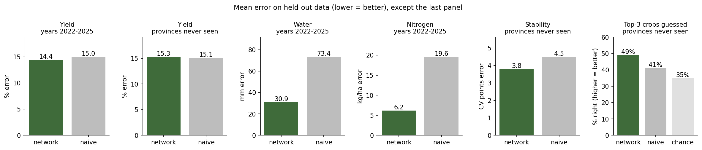
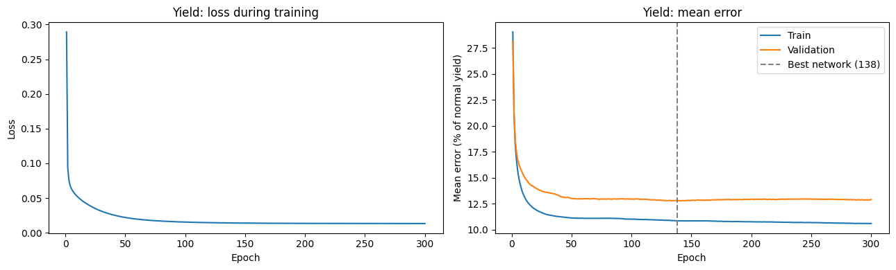
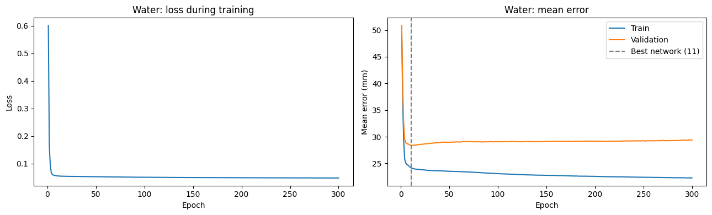
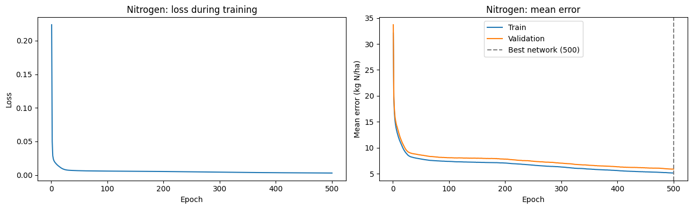
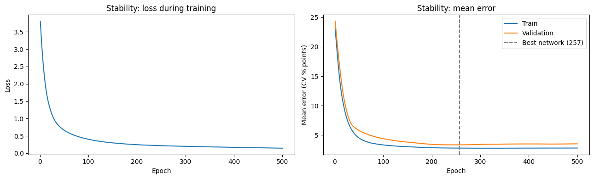

# FarmerBud: i risultati nel dettaglio

*[English version](results.md)* · Tutti i numeri vengono da `02_AI_Model/1_addestramento_reti_IT.ipynb` (salvato con gli output), salvo dove è scritto diversamente.

## Come facciamo i test
| Parte | Anni / province | A cosa serve |
|---|---|---|
| Train | 2006-2018 | aggiornare i pesi |
| Validazione | 2019-2021 | scegliere l'epoca e le impostazioni (es. `alpha`) |
| **Test** | **2022-2025** | solo il voto finale, mai per una scelta. Contiene la siccità del 2022 |
| **Province nuove** | una provincia alla volta lasciata fuori (33 prove) | la situazione vera dell'app: un campo in un posto che la rete non ha mai visto |

Ogni rete è confrontata con una **previsione banale**: la media della coltura nei dati di addestramento. Se una rete non la batte, non serve.

## 1. Rete della resa (il cuore dell'AI)
- **Test 2022-2025:** errore medio 14,4% della resa normale, banale 15,0%. Un piccolo vantaggio: con altri semi casuali la rete dà 14,4-15,5%, quindi in media è circa alla pari con la regola banale.
- **Province mai viste:** 15,3% contro 15,1%. Riga per riga, in un posto nuovo la rete **non** batte la regola banale.
- **Classifica (quello che fa l'app):** per ogni provincia abbiamo preso le 3 colture andate davvero meglio e contato quante ne indovina ogni metodo. Rete **49%**, regola banale 41%, caso 35%. Correlazione di rango (Spearman) con l'ordine vero: 0,37 per la rete, 0,17 per la regola banale.
- **Impostazione scelta sulla validazione:** con `alpha` 0,001 la rete imparava a memoria (test 16,7%), 0,1 era il migliore in validazione (12,8%) e l'abbiamo tenuto, 1,0 era troppo rigido.

**Errore per coltura, test 2022-2025 (% della resa normale)**
| Coltura | Rete | Banale |
|---|---|---|
| frumento tenero | **10,0** | 10,6 |
| riso | **10,9** | 13,0 |
| frumento duro | 13,4 | 13,3 |
| soia | **13,9** | 16,9 |
| orzo | 14,4 | 14,1 |
| barbabietola | **15,5** | 17,4 |
| mais | **15,6** | 18,5 |
| sorgo | 16,5 | **15,6** |
| colza | 16,6 | **15,6** |
| girasole | 17,1 | **14,7** |

La rete aiuta di più sulle colture estive che soffrono la siccità (mais, soia, barbabietola) e sul riso. Fa peggio della regola banale su girasole, sorgo e colza, che in molte province occupano pochi ettari.

**La siccità del 2022 (resa relativa media, 1,00 = normale)**
| Coltura | Vera | Rete | Banale |
|---|---|---|---|
| mais | 0,81 | 0,89 | 0,99 |
| soia | 0,85 | 0,93 | 0,99 |
| barbabietola | 0,77 | 0,92 | 0,99 |
| riso | 0,87 | 1,00 | 1,01 |
| frumento tenero | 1,02 | 1,06 | 1,01 |

La rete vede la siccità solo dal clima (direzione giusta per mais, soia, barbabietola), ma è troppo ottimista. Sbaglia il riso, probabilmente perché è sommerso e ha sofferto la mancanza d'acqua nei fiumi, una cosa che le nostre variabili di clima non misurano.

**Errore per regione, province mai viste (% della resa normale)**
| Regione | Rete | Banale |
|---|---|---|
| Veneto | 13,5 | 13,3 |
| Emilia-Romagna | 14,7 | 14,5 |
| Lombardia | 15,4 | 15,1 |
| Piemonte | 17,8 | 18,0 |

**Gli errori più grandi (province mai viste)**
| Provincia, anno, coltura | Vera | Rete | Perché pensiamo che sbagli |
|---|---|---|---|
| Biella 2012, mais | 1,60 | 0,78 | pochissimi ettari di mais: le rese ISTAT su superfici piccole sono rumorose |
| Torino 2025, soia | 1,51 | 0,74 | i dati 2025 sono ancora provvisori; un solo punto di clima per una provincia grande |
| Vercelli 2010-2011, girasole | 0,32 | 1,05 | coltura marginale in una provincia di risaie: superficie minima, risultati insoliti |

## 2. Rete dell'acqua
- **Test 2022-2025:** 31 mm contro 73 mm della regola banale.
- Impara in circa 10 epoche, poi smette di migliorare. Non scende sotto 25-30 mm perché vede solo i totali della stagione, mentre la formula FAO-56 lavora mese per mese: 100 mm di pioggia a marzo non aiutano il mais a luglio.
- Nel 2022 per il mais la formula dava 323 mm, la rete 345 mm, la regola banale 216 mm.
- **Limite:** per il riso il valore è solo l'evapotraspirazione; una risaia sommersa usa molta più acqua.

## 3. Rete dell'azoto
- **Test 2022-2025:** 6,2 kg/ha contro 19,6 kg/ha. Coltura peggiore: il mais (11,2 kg/ha), perché la scheda ufficiale è a gradini (150 kg/ha per 6-9 t/ha, 240 kg/ha per 10-14 t/ha) e una rete neurale disegna una curva morbida.
- Le scelte dell'agricoltore (erba medica l'anno prima, sostanza organica, residui interrati) nei dati ISTAT non ci sono: sono **simulate** a caso, così la rete vede tutte le combinazioni.

## 4. Rete della stabilità
- Target: il coefficiente di variazione (CV) vero della resa relativa di ogni provincia × coltura con almeno 10 anni: 255 righe.
- **7 province mai viste:** 3,8 punti di CV contro 4,5 della regola banale (CV mediano della coltura).
- **Perché una rete a parte:** prima abbiamo provato a ricavare la stabilità facendo prevedere alla rete della resa 20 anni di clima. Vedeva solo circa un terzo delle oscillazioni vere (CV mediano 4,6% contro 14,6% nella realtà, correlazione 0,22). Una rete addestrata direttamente sulla variabilità vera funziona meglio.
- **Limite:** poche righe, quindi la rete è minuscola (8 neuroni) e il risultato dipende da quali province finiscono nel test.

## Controlli sui dati
- **NASA POWER contro Open-Meteo** su 16 province (`01_Datasets/s3b_controllo_clima.py`): dopo la nostra correzione per la quota, differenza media di temperatura 0,0 °C, correlazione giornaliera 0,99; correlazione giornaliera dell'ET0 0,97; la pioggia NASA è il 20% più bassa, quindi per l'acqua la dividiamo per 0,80.
- **La formula dell'acqua è plausibile:** irrigazione mediana del mais circa 205 mm in un anno normale e 268 mm un anno su cinque, vicina ai valori abituali in Pianura Padana; cereali autunnali quasi zero, come nella realtà.

## Grafici dell'addestramento
Ogni grafico: a sinistra la loss usata per correggere i pesi, a destra l'errore medio su train e validazione.

