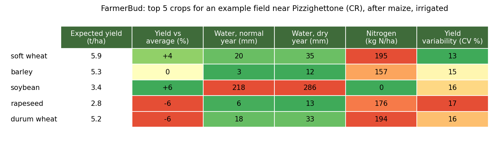

# 🌱 FarmerBud: which crops should I sow in my field?

**Track:** AI + Climate · **Team ByteRunners:** Mattia Gambetti, Amelia Nobile, Alessandra Muça

*[Versione italiana](README_IT.md)*

> This project is a prototype and is not agronomic advice.

[](https://colab.research.google.com/github/byterunnersAI/FarmerBud/blob/main/02_AI_Model/2_FarmerBud_app_EN.ipynb) ← the app · [](https://colab.research.google.com/github/byterunnersAI/FarmerBud/blob/main/02_AI_Model/1_training_networks_EN.ipynb) ← how the 4 networks are trained

**FarmerBud helps a small farmer in the Po Valley (northern Italy) by taking the location of their field, with a click on a map, and giving back the 5 most suitable crops with expected yield, irrigation water, nitrogen and year-to-year stability, plus advice in plain words.**

## The problem
Every autumn and spring a small farmer, or someone starting a farm, has to decide what to sow. In the Po Valley that choice is now a climate decision: in the 2022 drought maize yields fell about 19% below normal and soybean 15% (ISTAT data), while wheat, harvested before summer, was not affected. Water for irrigation is scarcer, and nitrogen fertiliser is expensive and pollutes. Large farms have agronomists; small ones usually decide by habit.

## What we built
- **Input:** a click on the map of the Po Valley. Optional: last year's crop, whether the farmer can irrigate, and their soil test (pH, clay, sand, silt, organic matter, nitrogen).
- **Output (in about 15 seconds):** a colour table of the 5 most suitable crops (green = better) and plain-language advice: which crops need a lot of water in a dry summer like 2022, which ones must not follow last year's crop because of pests or diseases, where the soil pH is not ideal.
- **How:** FarmerBud downloads 20 years of daily climate (2006-2025) and the soil for that exact point, runs 4 neural networks on each of the 20 years and ranks the crops.



## What we added
**Our own idea.** We built our own dataset by joining three public sources (ISTAT, NASA POWER, SoilGrids) for 33 lowland provinces, 10 crops and 20 years. We asked our own question: does it still work for a field in a province it has never seen? Our user is a small farmer choosing next season's crops.

## How it works
- **Data:** ISTAT crop yields per province, 2006-2025: 4,967 rows after cleaning (alfalfa removed: inconsistent units; 10 yields that were almost certainly typos removed). For each province: daily climate from NASA POWER, corrected for elevation and checked against Open-Meteo (mean temperature difference 0.0 °C, daily correlation 0.99), turned into 13 season variables per crop (rain, heat days, dry spells, FAO-56 evapotranspiration...). Soil from SoilGrids. The target is the **relative yield**: yield ÷ the crop's normal yield, so maize (10 t/ha) and soybean (3 t/ha) can be compared.
- **Models:** 4 small neural networks (scikit-learn `MLPRegressor`, 1-2 hidden layers), trained one epoch at a time with the error plotted:
  1. **Yield:** learns from real ISTAT yields how climate and soil change the yield. This is the core AI.
  2. **Water:** learns the FAO-56 irrigation formula from raw inputs (evapotranspiration, rain, crop).
  3. **Nitrogen:** learns the official Emilia-Romagna fertilisation sheets.
  4. **Stability:** learns how much the yield swings from year to year (real ISTAT variability).
- **Fair testing:** train 2006-2018, validation 2019-2021 (used only to choose settings), **test 2022-2025** (includes the 2022 drought, never used for any choice). For yield we also leave out one province at a time (*leave-one-province-out*), because a farmer's field is a new place.

## Results
| Test (held-out data) | Our network | Naive baseline |
|---|---|---|
| Yield, years 2022-2025 (mean error) | **14.4%** | 15.0% (crop average) |
| Yield, provinces never seen (mean error) | 15.3% | **15.1%** |
| **Top-3 crops guessed right, provinces never seen** | **49%** | 41% (chance: 35%) |
| Irrigation water, 2022-2025 | **31 mm** | 73 mm |
| Nitrogen, 2022-2025 | **6 kg/ha** | 20 kg/ha |
| Stability, provinces never seen | **3.8 CV points** | 4.5 CV points |

**Main takeaway:** predicting the exact yield of a new place is hard, and our network does not beat the naive guess there. But **ranking crops**, which is the decision the farmer actually makes, works clearly better than the naive rule and than chance. In the 2022 drought the network predicted maize at 0.89 of normal (truth 0.81, naive 0.99): right direction, too mild.

**Where it fails:**
- **Piedmont** has the largest errors (17.8%). Examples: Biella maize 2012 (true 1.60 × normal, predicted 0.78), Vercelli sunflower 2010 (true 0.32, predicted 1.05). These are provinces where the crop covers few hectares, so ISTAT yields are noisy, and one climate point per province cannot describe them.
- **The yield network is too smooth:** it sees only about one third of the real year-to-year swings. That is why stability has its own network.
- **The nitrogen network rounds off steps:** the official sheet jumps from 150 to 240 kg/ha for high-yield maize, the network draws a smooth curve.
- **Soil tests outside our data** (e.g. organic matter 1.5%) are brought back to the nearest known value, and the app warns the farmer.

More details, plots and all numbers: [03_Evaluation/results.md](03_Evaluation/results.md).

## What we'd do next
1. Train on field-level yields (farm records, shared with permission) instead of province averages, with more than one climate point per province.
2. Run future climate scenarios (e.g. +2 °C, drier summers) to show farmers how their top 5 crops would change.

## Sources
- **Data:** [ISTAT crops by province](https://esploradati.istat.it/databrowser/) (dataflow `101_1015_DF_DCSP_COLTIVAZIONI_2`); [NASA POWER daily API](https://power.larc.nasa.gov/docs/services/api/temporal/daily/); [ISRIC SoilGrids v2.0](https://rest.isric.org/soilgrids/v2.0/docs); [Open-Meteo](https://open-meteo.com/) (geocoding, elevation, climate check).
- **Agronomy:** [FAO Irrigation and Drainage Paper 56](https://www.fao.org/4/x0490e/x0490e00.htm) (ET0, crop coefficients); [Emilia-Romagna integrated production guidelines 2021](https://agricoltura.regione.emilia-romagna.it/produzioni-agroalimentari/temi/bio-agro-climambiente/agricoltura-integrata/Collezione-dpi/dpi_2021/norme/erbacee/raccolta-colture-erbacee.pdf) (nitrogen doses, rotations); [FAO ECOCROP via OpenCLIM](https://github.com/OpenCLIM/ecocrop) (pH, soil texture).
- **Libraries:** pandas, NumPy, scikit-learn, matplotlib, requests, joblib, ipyleaflet, ipywidgets, Jupyter, Google Colab.
- **AI tools:** Claude (Anthropic), through Claude Code, used as a coding assistant to write and debug the data scripts, the notebooks and these documents. Every number reported here comes from our notebooks, and we can explain every part.

---

## Repository guide

```
FarmerBud/
├── README.md / README_IT.md   this write-up (English / Italian)
├── requirements.txt           Python libraries
├── 01_Datasets/               how the data were built: scripts s1-s8, CSV files, sources (see its README)
├── 02_AI_Model/
│   ├── 1_training_networks_EN.ipynb   trains the 4 networks, error plots, tests vs baselines
│   ├── 1_addestramento_reti_IT.ipynb  same notebook in Italian
│   ├── 2_FarmerBud_app_EN.ipynb       the app: map, questions, results
│   ├── 2_FarmerBud_app_IT.ipynb       same app in Italian
│   └── modelli.joblib                 the 4 trained networks (created by notebook 1)
├── 03_Evaluation/             all results and plots (results.md / risultati.md)
├── 04_Presentation/           2-minute demo video script, team logo
└── 05_Submission/             answers for the submission form and final checklist
```

In the notebooks almost every line of code has a comment that explains it.

### Run it
- **Google Colab (easiest):** click the badge at the top, then *Runtime → Run all*. The notebooks download the data and the trained networks from this repository by themselves. In the app, scroll to the map and click on your field.
- **On your computer:** `pip install -r requirements.txt`, then `jupyter lab`, open `02_AI_Model/2_FarmerBud_app_EN.ipynb` and run all cells. To retrain the networks, run `1_training_networks_EN.ipynb` first (about 2 minutes).
- **On GitHub without running anything:** the notebooks are saved with their outputs. The interactive map is not shown on GitHub, but section 7 of the app shows a result already computed for an example field.
