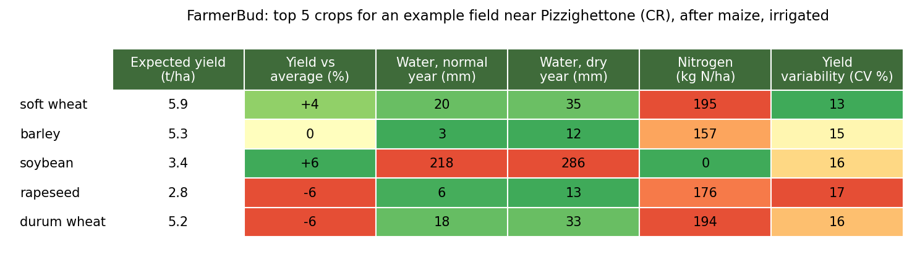

# 🌱 FarmerBud: quali colture seminare nel mio campo?

**Track:** AI + Climate · **Team ByteRunners:** Mattia Gambetti, Amelia Nobile, Alessandra Muça

*[English version](README.md)*

> Questo progetto è un prototipo e non è un consiglio agronomico.

[](https://colab.research.google.com/github/byterunnersAI/FarmerBud/blob/main/02_AI_Model/2_FarmerBud_app_IT.ipynb) ← l'app · [](https://colab.research.google.com/github/byterunnersAI/FarmerBud/blob/main/02_AI_Model/1_addestramento_reti_IT.ipynb) ← come si addestrano le 4 reti

**FarmerBud aiuta un piccolo agricoltore della Pianura Padana prendendo la posizione del suo campo, con un clic su una mappa, e restituendo le 5 colture più adatte con resa attesa, acqua di irrigazione, azoto e stabilità negli anni, più consigli in parole semplici.**

## Il problema
Ogni autunno e ogni primavera un piccolo agricoltore, o chi sta avviando un'azienda, deve decidere cosa seminare. In Pianura Padana questa scelta oggi è una decisione climatica: nella siccità del 2022 il mais ha reso circa il 19% in meno del normale e la soia il 15% (dati ISTAT), mentre il frumento, raccolto prima dell'estate, non ne ha risentito. L'acqua per irrigare è più scarsa e il concime azotato costa e inquina. Le grandi aziende hanno un agronomo; le piccole di solito decidono per abitudine.

## Cosa abbiamo costruito
- **Input:** un clic sulla mappa della Pianura Padana. Facoltativi: la coltura dell'anno scorso, se si può irrigare, l'analisi del terreno (pH, argilla, sabbia, limo, sostanza organica, azoto).
- **Output (in circa 15 secondi):** una tabella colorata con le 5 colture più adatte (verde = meglio) e consigli in parole semplici: quali colture chiedono molta acqua in un'estate secca come il 2022, quali non possono seguire la coltura dell'anno scorso per insetti o malattie, dove il pH del suolo non è ideale.
- **Come:** FarmerBud scarica 20 anni di clima giornaliero (2006-2025) e il suolo proprio di quel punto, fa lavorare 4 reti neurali su ognuno dei 20 anni e mette in classifica le colture.



## Cosa abbiamo aggiunto
**Un'idea nostra.** Abbiamo costruito il nostro dataset unendo tre fonti pubbliche (ISTAT, NASA POWER, SoilGrids) per 33 province di pianura, 10 colture e 20 anni. Ci siamo fatti una domanda nostra: funziona ancora per un campo in una provincia che la rete non ha mai visto? Il nostro utente è un piccolo agricoltore che sceglie le colture della prossima stagione.

## Come funziona
- **Dati:** rese ISTAT per provincia, 2006-2025: 4.967 righe dopo la pulizia (tolta l'erba medica, con unità di misura incoerenti, e 10 rese quasi certamente sbagliate). Per ogni provincia: clima giornaliero da NASA POWER, corretto per la quota e confrontato con Open-Meteo (differenza media di temperatura 0,0 °C, correlazione giornaliera 0,99), trasformato in 13 variabili della stagione di ogni coltura (pioggia, giorni di caldo, periodi secchi, evapotraspirazione FAO-56...). Suolo da SoilGrids. Il target è la **resa relativa**: resa ÷ resa normale della coltura, così mais (10 t/ha) e soia (3 t/ha) si possono confrontare.
- **Modelli:** 4 piccole reti neurali (`MLPRegressor` di scikit-learn, 1-2 strati nascosti), addestrate un'epoca alla volta con il grafico dell'errore:
  1. **Resa:** impara dalle rese vere ISTAT come clima e suolo cambiano la resa. È il cuore dell'AI.
  2. **Acqua:** impara la formula FAO-56 dell'irrigazione partendo dagli ingredienti grezzi (evapotraspirazione, pioggia, coltura).
  3. **Azoto:** impara le schede ufficiali di concimazione dell'Emilia-Romagna.
  4. **Stabilità:** impara quanto la resa oscilla da un anno all'altro (variabilità vera ISTAT).
- **Test onesti:** train 2006-2018, validazione 2019-2021 (solo per scegliere le impostazioni), **test 2022-2025** (con la siccità del 2022, mai usato per nessuna scelta). Per la resa lasciamo anche fuori una provincia alla volta (*leave-one-province-out*), perché il campo di un agricoltore è un luogo nuovo.

## Risultati
| Test (dati mai visti) | La nostra rete | Previsione banale |
|---|---|---|
| Resa, anni 2022-2025 (errore medio) | **14,4%** | 15,0% (media della coltura) |
| Resa, province mai viste (errore medio) | 15,3% | **15,1%** |
| **Le 3 colture migliori indovinate, province mai viste** | **49%** | 41% (a caso: 35%) |
| Acqua di irrigazione, 2022-2025 | **31 mm** | 73 mm |
| Azoto, 2022-2025 | **6 kg/ha** | 20 kg/ha |
| Stabilità, province mai viste | **3,8 punti di CV** | 4,5 punti di CV |

**Il messaggio principale:** prevedere la resa esatta di un luogo nuovo è difficile, e lì la nostra rete non batte la previsione banale. Ma **mettere in classifica le colture**, che è la decisione che l'agricoltore prende davvero, funziona chiaramente meglio della regola banale e del caso. Nella siccità del 2022 la rete ha previsto il mais a 0,89 del normale (vero 0,81, banale 0,99): direzione giusta, ma troppo ottimista.

**Dove sbaglia:**
- **Il Piemonte** ha gli errori più grandi (17,8%). Esempi: mais a Biella nel 2012 (vero 1,60 volte il normale, previsto 0,78), girasole a Vercelli nel 2010 (vero 0,32, previsto 1,05). Sono province dove quella coltura occupa pochi ettari, quindi le rese ISTAT sono rumorose, e un solo punto di clima per provincia non basta a descriverle.
- **La rete della resa è troppo "tranquilla":** vede solo circa un terzo delle oscillazioni vere da un anno all'altro. Per questo la stabilità ha una rete sua.
- **La rete dell'azoto arrotonda i gradini:** la scheda ufficiale salta da 150 a 240 kg/ha per il mais ad alta produzione, la rete disegna una curva morbida.
- **Analisi del terreno fuori dai nostri dati** (es. sostanza organica 1,5%): i valori vengono riportati al più vicino che le reti conoscono e l'app avvisa l'agricoltore.

Tutti i dettagli, i grafici e i numeri: [03_Evaluation/risultati.md](03_Evaluation/risultati.md).

## Cosa faremmo dopo
1. Addestrare su rese del singolo campo (dati di aziende, condivisi con permesso) invece che sulle medie provinciali, con più punti di clima per provincia.
2. Simulare il clima futuro (es. +2 °C, estati più secche) per mostrare agli agricoltori come cambierebbero le loro 5 colture migliori.

## Fonti
- **Dati:** [ISTAT coltivazioni per provincia](https://esploradati.istat.it/databrowser/) (dataflow `101_1015_DF_DCSP_COLTIVAZIONI_2`); [NASA POWER, API giornaliera](https://power.larc.nasa.gov/docs/services/api/temporal/daily/); [ISRIC SoilGrids v2.0](https://rest.isric.org/soilgrids/v2.0/docs); [Open-Meteo](https://open-meteo.com/) (geocoding, quota, controllo del clima).
- **Agronomia:** [FAO Irrigation and Drainage Paper 56](https://www.fao.org/4/x0490e/x0490e00.htm) (ET0, coefficienti colturali); [Disciplinari di produzione integrata Emilia-Romagna 2021](https://agricoltura.regione.emilia-romagna.it/produzioni-agroalimentari/temi/bio-agro-climambiente/agricoltura-integrata/Collezione-dpi/dpi_2021/norme/erbacee/raccolta-colture-erbacee.pdf) (dosi di azoto, rotazioni); [FAO ECOCROP tramite OpenCLIM](https://github.com/OpenCLIM/ecocrop) (pH, tessitura).
- **Librerie:** pandas, NumPy, scikit-learn, matplotlib, requests, joblib, ipyleaflet, ipywidgets, Jupyter, Google Colab.
- **Strumenti AI:** Claude (Anthropic), tramite Claude Code, usato come assistente di programmazione per scrivere e correggere gli script dei dati, i notebook e questi documenti. Ogni numero riportato qui viene dai nostri notebook, e sappiamo spiegare ogni parte.

---

## Guida al repository

```
FarmerBud/
├── README.md / README_IT.md   questo write-up (inglese / italiano)
├── requirements.txt           librerie Python
├── 01_Datasets/               come sono stati costruiti i dati: script s1-s8, CSV, fonti (vedi il suo README)
├── 02_AI_Model/
│   ├── 1_addestramento_reti_IT.ipynb  addestra le 4 reti, grafici dell'errore, confronto con le baseline
│   ├── 1_training_networks_EN.ipynb   lo stesso notebook in inglese
│   ├── 2_FarmerBud_app_IT.ipynb       l'app: mappa, domande, risultati
│   ├── 2_FarmerBud_app_EN.ipynb       la stessa app in inglese
│   └── modelli.joblib                 le 4 reti addestrate (create dal notebook 1)
├── 03_Evaluation/             tutti i risultati e i grafici (risultati.md / results.md)
├── 04_Presentation/           copione del video demo di 2 minuti, logo del team
└── 05_Submission/             risposte per il modulo di invio e checklist finale
```

Nei notebook quasi ogni riga di codice ha un commento che la spiega.

### Come si usa
- **Google Colab (il modo più facile):** clicca il badge in alto, poi *Runtime → Esegui tutte*. I notebook scaricano da soli dati e reti da questo repository. Nell'app scorri fino alla mappa e clicca sul tuo campo.
- **Sul tuo computer:** `pip install -r requirements.txt`, poi `jupyter lab`, apri `02_AI_Model/2_FarmerBud_app_IT.ipynb` ed esegui tutte le celle. Per riaddestrare le reti esegui prima `1_addestramento_reti_IT.ipynb` (circa 2 minuti).
- **Su GitHub senza eseguire niente:** i notebook sono salvati con gli output. La mappa interattiva su GitHub non si vede, ma la sezione 7 dell'app mostra un risultato già calcolato per un campo di esempio.
